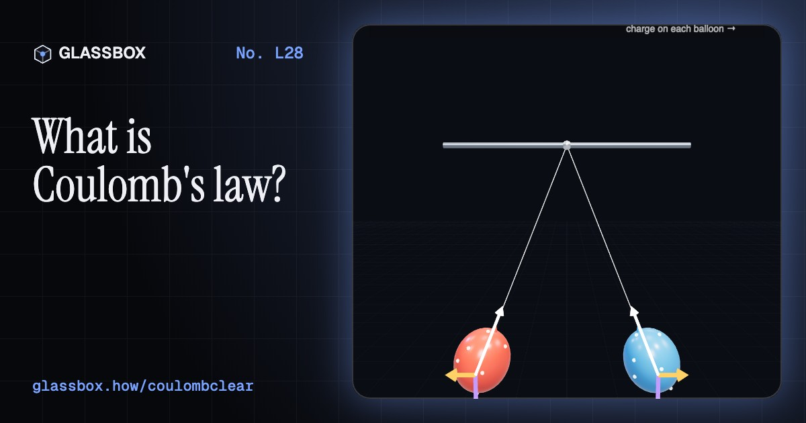
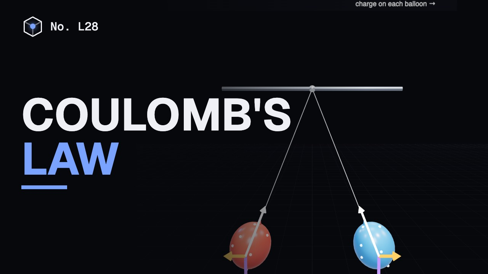
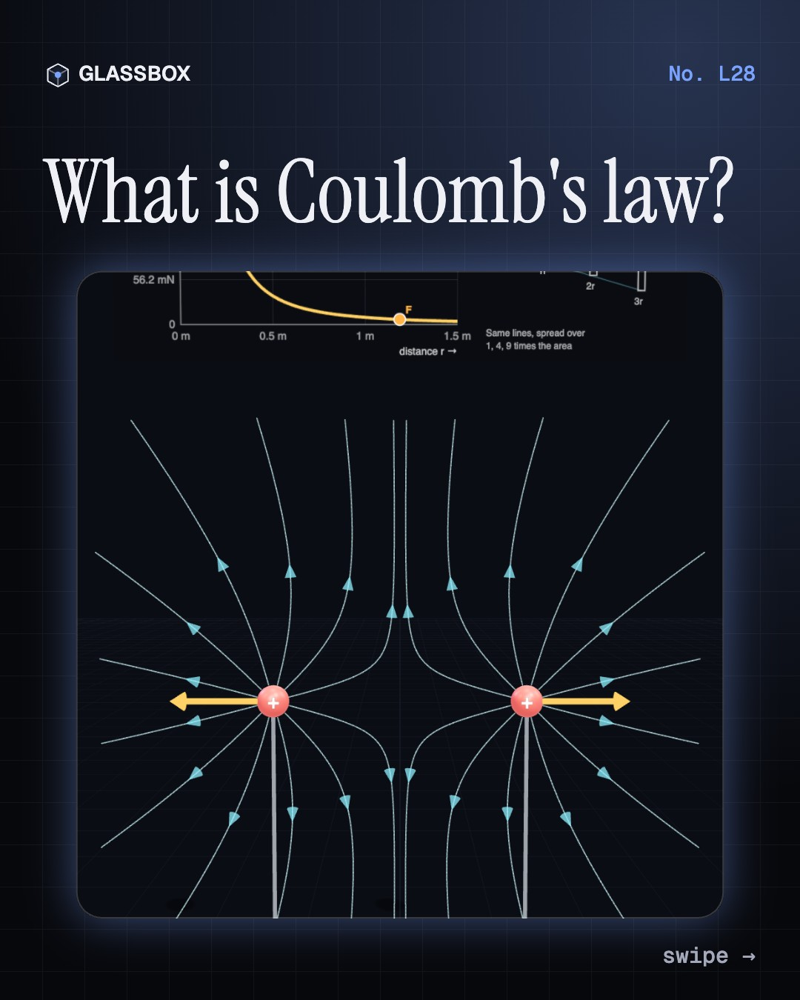
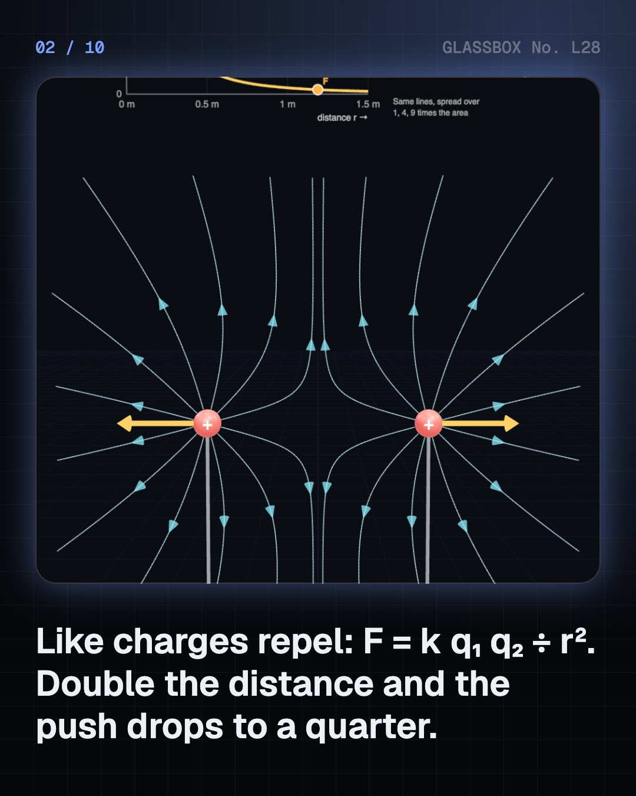
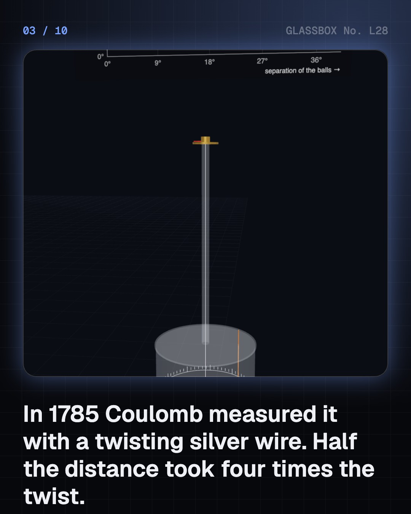
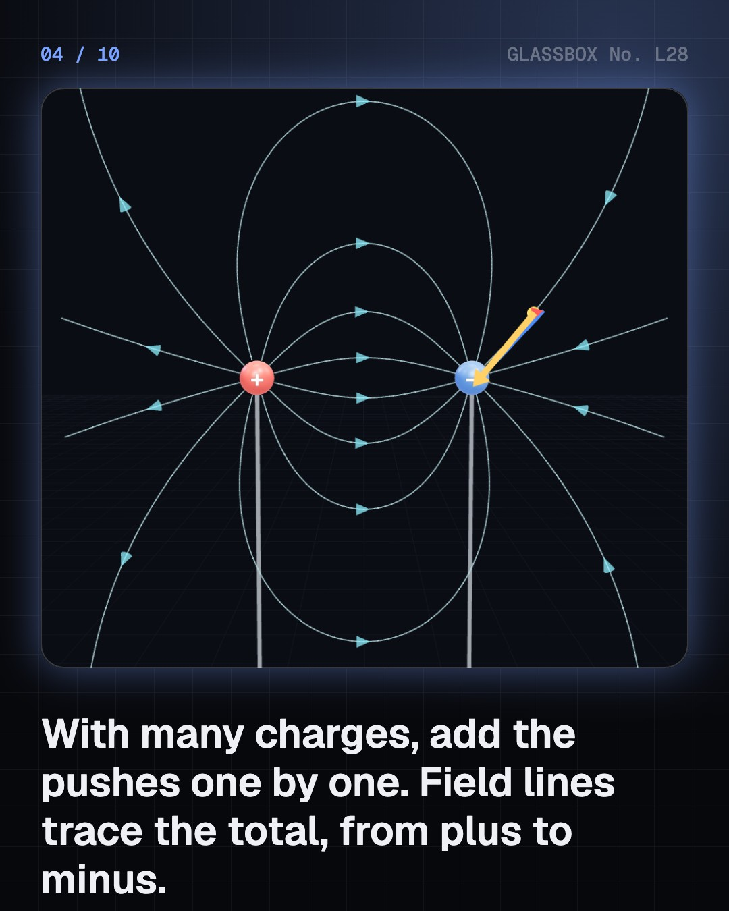

<!-- glassbox:start -->
<!-- Generated from glassbox.json by the Glassbox hub (npm run readme -- coulombclear). Edit glassbox.json, not this block. -->
<p align="center"><a href="https://glassbox.how/e/coulombclear/"></a></p>

<h1 align="center">Coulomb's law</h1>

<p align="center"><b>What is Coulomb's law?</b><br>Two protons push each other apart 10³⁶ times harder than gravity pulls them together. Trace field lines from the charges themselves, twist Coulomb's silver wire from 1785, hang two rubbed balloons, get zapped by a door handle on a dry winter day, stand under a thundercloud, and watch toner leap in a laser printer.</p>

<p align="center"><a href="https://glassbox.how/coulombclear/"><b>▶ Play with it</b></a> &nbsp;·&nbsp; <a href="https://glassbox.how/e/coulombclear/">Read the 60-second explainer</a> &nbsp;·&nbsp; <a href="https://glassbox.how/coulombclear/glassbox/reel.mp4">Watch the 40-second video</a></p>

<p align="center">
  <a href="https://glassbox.how/e/coulombclear/"></a>
  <a href="https://glassbox.how/e/coulombclear/"></a>
  <a href="LICENSE"></a>
  <a href="LICENSE-CONTENT.md"></a>
  <a href="#privacy"></a>
</p>

## In 60 seconds

1. **Like repels, unlike attracts.** F = k q₁ q₂ ÷ r², with k = 8.99 × 10⁹ N m²/C². Two balls with a microcoulomb each, half a metre apart, push with 36 mN. Double the distance and the force drops to a quarter. Coulomb measured it in 1785 with a twisting silver wire: half the distance needed four times the twist.
2. **Many charges: add the arrows.** With several charges, work out each push alone and add them. That sum, per unit of charge, is the electric field, and field lines trace it from plus to minus. It also explains why a charged comb lifts neutral paper: the field polarises the scrap, and the pull falls as fast as 1 ÷ r⁵.
3. **Static at home.** Rubbing moves electrons; it never makes charge. Two balloons with 0.5 µC each hang half a metre apart. On a dry winter day a walk across a carpet can charge you to 30,000 V, about 4 µC and 50 mJ, and a spark jumps to the door handle. In humid air the charge leaks away.
4. **From thunderclouds to toner.** A cloud with ±40 C at 6 and 12 km makes about 15 kV/m at the ground below, and its two charge centres pull on each other with 400 kN. In a laser printer a field of 1 MV/m throws each toner grain at the drum with 2,000 times its weight.
5. **Gravity's twin, and the limits.** Same shape as gravity, but 1.2 × 10³⁶ times stronger between two protons. Gravity still rules planets because charges cancel. Inside a charged shell there is no force, but only if the power is exactly 2: measured to 16 decimal places. That shell effect, not rubber tyres, keeps you safe in a car in a storm.

## Words worth knowing

| Term | Meaning |
|---|---|
| **Electric charge** | A property of matter, positive or negative, that makes it push or pull other charges. Measured in coulombs. |
| **Coulomb's law** | The force between two charges is k q₁ q₂ ÷ r²: a push for like charges, a pull for unlike ones. |
| **Coulomb's constant (k)** | 8.99 × 10⁹ N m²/C²: the force between two 1 C charges 1 m apart. |
| **Inverse-square law** | A force that falls with the square of distance: twice as far, a quarter as strong. |
| **Electric field** | The force on each coulomb of charge at a point, in volts per metre. Field lines show its direction. |
| **Superposition** | The total force from many charges is the sum of the forces from each one alone. |
| **Conductor and insulator** | Charge moves freely through a conductor such as metal, and stays put on an insulator such as rubber or dry air. |
| **Faraday cage** | A closed metal shell. Charge stays on its outside, so the field inside is zero. |

## A short history

**From a rubbed lump of amber to a twisting silver wire, a counted electron and a unit fixed by a constant of nature.**

- **600 BCE** · Rubbed amber picks up straw (Thales of Miletus (attributed), Miletus, Ionia)
- **1600** · Electricity gets a name (William Gilbert, London, England)
- **1729** · Charge can travel: conductors and insulators (Stephen Gray and Granville Wheler, Otterden Place, Kent)
- **1733** · Two kinds of electricity (Charles François de Cisternay du Fay, Paris)
- **1747** · Positive and negative (Benjamin Franklin (and William Watson), Philadelphia)
- **1767** · Priestley guesses the inverse square (Joseph Priestley, Warrington, England)
- **1773** · Cavendish tests it and tells no one (Henry Cavendish, London)
- **1785** · Coulomb measures the force (Charles-Augustin de Coulomb, Paris)

The full story, with 20 moments, charts, people and 26 sources: [glassbox.how/e/coulombclear/history](https://glassbox.how/e/coulombclear/history/). The data lives in [`history.json`](history.json).

## Video and slides

Made with the Glassbox studio from this box's storyboard (`window.glassbox.director`). Free to reuse under CC BY 4.0.

<a href="https://glassbox.how/coulombclear/glassbox/video.mp4"></a>

<p><a href="glassbox/slide-1.jpg"></a> <a href="glassbox/slide-2.jpg"></a> <a href="glassbox/slide-3.jpg"></a> <a href="glassbox/slide-4.jpg"></a></p>

| File | What | Size |
|---|---|---|
| [`glassbox/reel.mp4`](https://glassbox.how/coulombclear/glassbox/reel.mp4) | Reel / Short, with captions and soundtrack | 1080×1920 |
| [`glassbox/video.mp4`](https://glassbox.how/coulombclear/glassbox/video.mp4) | YouTube video, with captions and soundtrack | 1920×1080 |
| `glassbox/slide-1…10.jpg` | Instagram carousel | 1080×1350 |
| `glassbox/thumb.jpg` | YouTube thumbnail | 1280×720 |
| `glassbox/cover.jpg` | Share card and repo social preview | 1200×630 |
| [`glassbox/history-reel.mp4`](https://glassbox.how/coulombclear/glassbox/history-reel.mp4) | “History in 10 moments” Reel / Short | 1080×1920 |
| `glassbox/history-slide-*.jpg` | History carousel | 1080×1350 |
| `glassbox/post.json` | Post copy and schedule used by the publish kit | |

## Privacy

This box has no accounts and no ads, and it ships its own fonts and libraries. When you run it yourself it sends nothing anywhere. On glassbox.how, the site's `/bar.js` also loads Glassbox's analytics: **Google Analytics** to count visits (it asks first in the EU, UK and Switzerland, and stays off when your browser sends Global Privacy Control or Do Not Track) and **ClickTrust** to detect bots.

It remembers a few things **in your own browser only**, and never sends them anywhere:

| Browser storage key | What it holds |
|---|---|
| `coulombclear.v1` | Which chapters you have opened, your best quiz scores, and sound on or off. |

Exactly what each one sees is at [glassbox.how/privacy](https://glassbox.how/privacy/).

## Licences

- **Code:** [MIT](LICENSE). Use it, change it, ship it.
- **Explanations, text, images and videos** (`glassbox.json`, `glassbox/`): [CC BY 4.0](LICENSE-CONTENT.md). Credit “Glassbox, glassbox.how/e/coulombclear”.
- **Third-party parts** keep their own licences: [three.js](https://threejs.org) (MIT), [Geist, Instrument Serif](https://openfontlicense.org) (SIL OFL 1.1).
- The Glassbox name and logo aren't covered by either licence. See the [terms](https://glassbox.how/terms/).

Found a mistake? [Open an issue](https://github.com/bdeeps/coulombclear/issues). Corrections happen in public.
<!-- glassbox:end -->

## Run it

It's plain HTML, CSS and JavaScript. No build step and no dependencies. Run locally, it contacts no other website.

```bash
python3 -m http.server 8000
```

Three.js and the fonts ship in `vendor/` and `fonts/`, so it also works offline.

Then open http://localhost:8000.

## How it's built

| File | What |
|---|---|
| `index.html`, `css/app.css` | The page and its styles |
| `js/app.js`, `js/stage.js`, `js/ui.js`, `js/kit.js` | The shared Glassbox 3D engine: chapters, 3D stage, controls, quiz, video director |
| `js/chapters/*.js` | One file per chapter: the 3D model, controls, text, key terms, quiz and video scenes |
| `js/coulomb.js` | Shared physics and parts: constants, Coulomb's law, the field of point charges and the field-line tracer, charged balls, chart boards, arrows |
| `glassbox.json` | Title, question, explainer beats, key terms, browser storage and credits shown on glassbox.how |
| `reel` in each chapter | The storyboard the Glassbox studio records into short videos |
| `glassbox/` | The published video, slides, thumbnail and post copy |
| `fonts/`, `vendor/three/` | Self-hosted Geist and Instrument Serif (SIL OFL 1.1) and three.js (MIT) |
